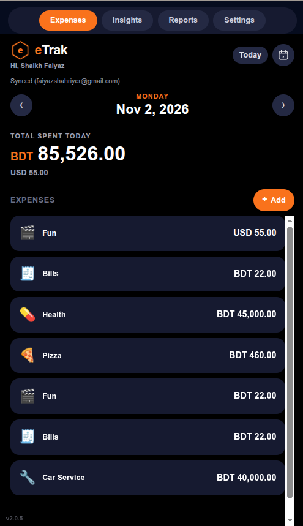
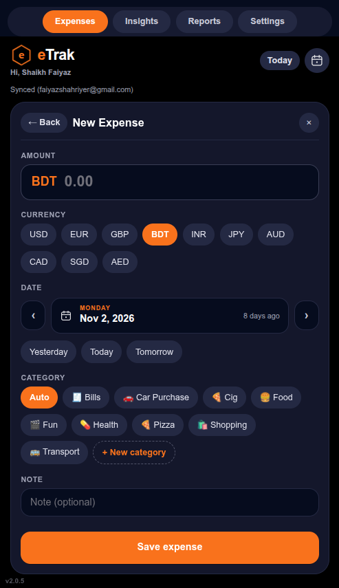
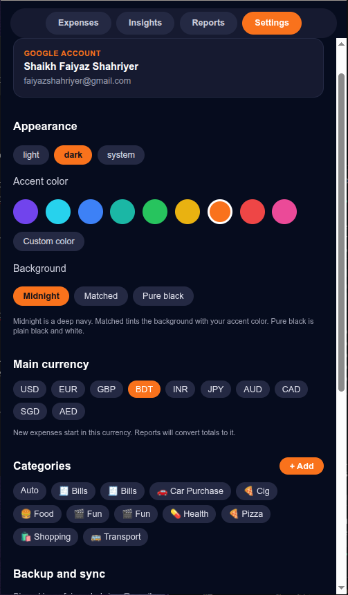

# eTrak

[](https://etrak.pages.dev)
[](https://drive.google.com/drive/folders/1jASpEzP-8vFqLG5OkykLKU_-kV2GDsnf?usp=sharing)

> **Live Web Demo:** Access the browser-based PWA running directly on [Cloudflare Pages](https://etrak.pages.dev).
>
> **Android Testers:** Download the standalone `.apk` directly from [Google Drive](https://drive.google.com/drive/folders/1jASpEzP-8vFqLG5OkykLKU_-kV2GDsnf?usp=sharing). Ensure *Install from Unknown Sources* is enabled on your device.

eTrak is a private, lightweight, and offline-first personal expense tracking application built with Expo, React Native for Web, and SQLite running directly inside the browser via OPFS (Origin Private File System).

---

## Screenshots

| Dashboard & Daily Totals | Inline Expense Logging | Custom Themes & Sync |
| :---: | :---: | :---: |
|  |  |  |

---

## Features

- **Offline-First SQLite Architecture:** Fast local reads and writes using SQLite running entirely inside the client browser. No central server or third-party tracking database.
- **Google Drive Backup & Sync:** Backs up data directly into the user's private Google Drive `appDataFolder` using OAuth 2.0.
- **Cross-Device Sync:** Changes merge seamlessly across mobile and desktop environments.
- **Responsive Inline Entry:** Adaptive expense logging layout designed to prevent mobile input jumping and keyboard overflow.
- **Dynamic Themes:** Full Dark and Light mode support with customizable accent palettes powered by NativeWind.
- **Multi-Currency Tracking:** Log expenses across currencies with grouped daily totals.
- **Zero-Cost Hosting:** Fully exportable as a static single-page application compatible with edge hosts like Cloudflare Pages.

---

## Tech Stack

| Layer | Technologies |
| :--- | :--- |
| **Framework** | [Expo](https://expo.dev/) (React Native for Web), [Expo Router](https://docs.expo.dev/router/introduction/) |
| **Styling** | [NativeWind v4](https://www.nativewind.dev/) (Tailwind CSS) |
| **Database** | SQLite via browser OPFS (Origin Private File System) |
| **Cloud Storage** | Google Drive REST API (`drive.appdata` scope) |
| **Tooling** | pnpm workspaces, ESLint, Prettier, Commitlint, Husky |
| **Hosting** | Cloudflare Pages |

---

## Getting Started

### Prerequisites
- Node.js (v18 or higher)
- [pnpm](https://pnpm.io/) (`corepack enable pnpm`)

### Installation

```bash
# Clone the repository
git clone https://github.com/hypershot116/eTrak.git
cd eTrak

# Install workspace dependencies
pnpm install
```

### Environment Configuration

Create an environment configuration file in `apps/mobile/.env`:

```env
EXPO_PUBLIC_GOOGLE_WEB_CLIENT_ID="<your-google-oauth-client-id>.apps.googleusercontent.com"
```

### Local Development

```bash
# Start the Expo development server
pnpm --filter @etrak/mobile dev

# Or start directly with the web platform target
pnpm --filter @etrak/mobile web
```

---

## Building for Production

To export the web client for static hosting:

```bash
cd apps/mobile
pnpm expo export --platform web
```

The compiled output will be generated inside `apps/mobile/dist`, ready to deploy to Cloudflare Pages, Vercel, or GitHub Pages.

---

## Architectural Notes

### Multi-Tab Concurrency in Browsers
eTrak utilizes the browser's Origin Private File System (OPFS) to persist SQLite databases locally. Modern browsers strictly enforce an exclusive file-system lock on active files to protect against write corruption. As a result, eTrak supports one active browser tab per device at a time, displaying an informative lock banner on duplicate tabs while maintaining cross-device synchronization via Google Drive.
